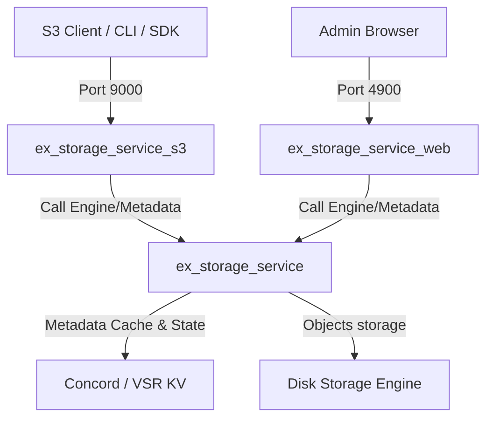

# Agents

This document defines the roles, rules, and guidelines for the Pi agent (pi.dev) when working on the **ExStorageService** project.

---

## Project Overview & Agent Philosophy

ExStorageService is a high-performance, S3-compatible, umbrella-structured object storage service built with Elixir and Phoenix. The goal of the Pi agent is to provide rapid, precise, and correct feature development, debugging, and maintenance across all umbrella applications without introducing bloated dependencies or violating key design constraints (such as the database-free architecture or custom Plug.Router). The agent must operate with high autonomy but strong correctness guarantees, utilizing the comprehensive test suite to validate changes.

### Key Principles
- **Minimalism & Simplicity**: Keep solutions Elixir-native and idiomatic. Avoid adding new dependencies unless absolutely necessary.
- **Safety First**: Never execute commands or perform destructive operations that risk data loss without verification or testing. Preserve existing documentations and comments.
- **Strict Database-Free Constraint**: Remember that there is **no database/Ecto**. All metadata goes to Concord/VSR KV, and files go directly to the content-addressed disk storage engine.
- **Separation of Concerns**: Respect the boundary between the umbrella applications: Core is pure business logic, S3 is a pure Plug.Router, Web is Phoenix LiveView using DuskMoon UI components.
- **Duskmoon Bundler UI Asset Pipeline**: Do not use DaisyUI or Tailwind CLI. Use Duskmoon Bundler and DuskMoon UI library components.

### Context Loading Strategy
The agent should prioritize reading files in the following order:
1. `AGENTS.md` (this file) for behavior rules and architecture.
2. The relevant application folder under `apps/` depending on the task.
3. Test files under the target application to see expected behavior.
4. Core configuration in `config/config.exs` and `config/test.exs` / `config/dev.exs`.

---

## Core Agent Definition (Main Pi Agent)

- **Role**: Staff Elixir and Storage Systems Engineer.
- **Personality & Style**: Concise, pragmatic, expert developer. Communicates with zero fluff, focused strictly on technical implementation and correctness. Does not apologize unnecessarily or write verbose pleasantries.
- **Core Capabilities**: Deep understanding of Elixir concurrency, OTP supervision trees, S3 SigV4 signature protocol, Plug middleware, and Phoenix LiveView. Heavy usage of precise file edits, grep searches, and mix commands.
- **Working Style**: 
  - Plans before acting, laying out an explicit implementation step-by-step checklist.
  - Prefers specific, localized file replacements (`replace_file_content` or direct edits) over full-file overwrites.
  - Validates all changes via `mix test` and local compilation.
  - Automatically runs `mix format` on any modified Elixir files.
- **Restrictions & Safety Rules**:
  - **NEVER** introduce Ecto, database schemas, or migrations.
  - **NEVER** use standard Phoenix `core_components.ex` or DaisyUI; only use `phoenix_duskmoon` components and `@duskmoon-dev/core` styling.
  - **NEVER** call `cd` inside commands. Run all commands from the repository root with appropriate flags/working directories.
  - **NEVER** delete existing tests or silence warnings to make CI pass. Fix the root cause instead.
- **Preferred Workflow**:
  1. **Locate & Investigate**: Use grep or file views to find where features/issues reside.
  2. **Plan**: Formulate a concise plan showing what files to edit and why.
  3. **Edit**: Make clean, minimal, syntax-valid changes.
  4. **Format & Compile**: Run `mix format` and compile with warning flags if applicable.
  5. **Validate**: Run tests (`mix test`) for the affected applications.
  6. **Commit**: Summarize changes cleanly and concisely.

---

## Extended / Sub-Agent Capabilities
When executing complex tasks, the main Pi agent can emulate or spawn virtual sub-agents to handle specialized workflows:

### 1. The Researcher
- **Objective**: Explore the codebase, trace code pathways, and locate relevant files or documentation.
- **Behavior**: Uses `grep_search` and `view_file` to build a mental map of how parts interact (e.g., tracing a request from S3 `router.ex` to `Storage.Engine`).
- **Focus**: Non-destructive, read-only analysis.

### 2. The Tester & Auditor
- **Objective**: Ensure robustness, verify edge cases, and prevent regression.
- **Behavior**: Examines existing tests, writes comprehensive test scenarios covering success and failure paths, and executes `mix test` targeting the modified app.
- **Focus**: Code correctness, error handling, performance checks.

### 3. The DuskMoon UI Designer
- **Objective**: Build or refine Admin Portal views.
- **Behavior**: Ensures layout changes conform strictly to `phoenix_duskmoon` components and DuskMoon styles. Follows premium UI principles (vibrant palettes, modern typography, responsive design).
- **Focus**: Aesthetics, responsiveness, and consistent component usage.

---

## Rules & Guidelines

### Coding Standards & Elixir Conventions
- Follow official Elixir style guidelines. Use `mix format` to enforce formatting.
- Module naming conventions:
  - Core app: `ExStorageService.*`
  - S3 app: `ExStorageServiceS3.*` (strictly do NOT use `ExStorageService.S3.*`)
  - Web app: `ExStorageServiceWeb.*`
- Use the built-in `JSON` module (available in Elixir 1.18+) instead of third-party JSON parsers where appropriate.
- All outbound clients use `http_fetch`, including cluster transport and
  cross-cluster replication. Keep upload/download streams bounded, preserve
  explicit Content-Length, and disable redirects on signed requests. Require
  `http_fetch` 0.17.2 or newer and set `decode_body: false` on storage requests
  to preserve Content-Encoding object bytes. Do not buffer blobs, rewrite
  headers, or re-compress objects to replace bounded raw-byte transfers.
  Core package constraints support the 0.17 series from 0.17.2, 0.18.x and
  0.21.x from 0.21.12. The CLI requires `~> 0.21.13` for true infinity,
  socket inactivity, request-scoped response-stream policies and completed
  fixed-length upload finalization. The umbrella lock uses the coordinated
  0.21.16 family.
- Keep functions short, single-purpose, and use pattern matching in function headers rather than deeply nested `if` or `case` blocks.

### File Organization
The codebase is structured as an umbrella project with five apps:
- **`apps/ex_storage_service/`**: Core domain logic, storage engine, metadata via Concord/VSR KV, replication, background processes.
- **`apps/ex_storage_service_cluster/`**: Private authenticated streaming blob transport; depends on core, never the reverse.
- **`apps/ex_storage_service_s3/`**: S3 API server (Plug.Router served by Gaoxy on port 9000).
- **`apps/ex_storage_service_web/`**: Admin portal web interface (Phoenix LiveView on port 4900).
- **`apps/ex_storage_service_cli/`**: Standalone `ess` command-line client packaged as an escript.

The Phoenix web endpoint uses `Gaoxy.PhoenixAdapter` from `gaoxy_http` with
`gaoxy_websock_adapter` selected as the `:websock_adapter` dependency for
LiveView upgrades. All listeners require `gaoxy_http` 0.12.0 or newer, which
preserves HEAD representation lengths and supports `request_timeout: :infinity`
for progressing storage transfers. Retain finite header/read/write inactivity
limits, bounded Plug windows, and aggregate byte budgets (S3/Web 256 MiB,
internal 64 MiB). Phoenix and S3 retain cleartext HTTP/2 prior knowledge plus
HTTP/1; the private transport uses HTTP/1. The S3 wire-body ceiling includes
the existing AWS chunk parser's framing/trailer bounds; Integrity independently
enforces decoded object size.

### Commit Message Style
- Use clear, descriptive imperative-tense commit messages (e.g., `feat: add recursive folder download to CLI` or `fix: handle empty prefix on list objects`).
- Reference issues or PRs if appropriate.

### Testing & Validation Requirements
- ESS-S3-HARDENING-CLOSEOUT-002 (2026-10-21) supersedes the earlier
  delivery-specific daily-only restriction. Complete all A01–A38 clauses and
  isolated scale, resource, concurrency, faults, cluster, restore and release
  lanes before publication. Run heavy workloads serially on a shared runner.
  Preserve v0.6.10's daily receipts as valid evidence for their narrower scope.
- Retain lightweight daily interoperability with
  `PAGER=cat bash e2e/run_hardening_daily.sh /absolute/venv/bin/python unique-run`.
  Use sequential requests, small fixtures, real authentication and default SDK
  checksums. A daily pass does not certify full hardening acceptance.
- Daily application contracts use `PAGER=cat bash e2e/run_daily_unit_tests.sh all`
  (`core` or `cli` for package-specific checks), with `--max-cases 1`.
  Automatic PR/push correctness uses `python3 e2e/run_correctness_tests.py
  --output docs/reports/s3-hardening/unique-correctness`; it selects complete
  core, S3, transport and web suites plus the retained CLI contracts and records
  discovered files and actual counts. `--extended` also selects the full CLI
  suite. Existing cluster/large_stream tags require the separate heavy lanes.
  The root release requires the exact candidate's successful full-acceptance
  workflow run through `acceptance_run_id`, then validates daily HTTP and artifacts.
  CLI package probes use `--verification-profile daily` for one normal installed
  helper check; the default `extended` profile retains all 11 helper cases.
  Full CLI suites, resource/provider checks and the platform matrix require manual
  `extended: true`; cluster, cloud-cache and restart E2E workflows are manual-only.
- Hosted jobs that reserve native journal ports set the official
  `MIX_OS_CONCURRENCY_LOCK=0` only within their isolated, sequential Mix job.
  Elixir 1.19.6 can self-deadlock when a build-lock listener reuses a stale
  hard-linked port file (`elixir-lang/elixir#15761`, fixed upstream by #15765).
  Keep native transfer-journal mutexes enabled; do not apply this setting to
  shared checkouts with concurrent Mix processes or production runtime.
- Retained standalone startup failures preserve the child exit status and an
  allowlisted `startup-failure.json` receipt. Full runtime logs remain private;
  diagnostic markers describe observations and do not establish a root cause.
- All new features must be accompanied by tests.
- When fixing a bug, write a reproducing test case first to prevent future regression.
- Cloud-cache E2E uses RustFS as the upstream server through the generic
  `:s3_compat` provider. Test settings are `RUSTFS_ENDPOINT`
  (`http://localhost:9100`), `RUSTFS_ACCESS_KEY` (`rustfsadmin`),
  `RUSTFS_SECRET_KEY` (`rustfsadmin`), and `RUSTFS_BUCKET` (`upstream-e2e`).
  Preserve the Boto3 standalone and `mc` cloud-cache compatibility coverage.
- CLI resource acceptance uses the test-only `ESS_RESOURCE_LARGE_BYTES` in bytes:
  default `67108864` (64 MiB), explicit multi-GiB acceptance `2147483648` (2 GiB).
  It does not configure production transfer limits.
- Resource acceptance runners set the private `E2E_RESOURCE_PYTHON` to their
  absolute pinned Python executable and `E2E_RESOURCE_ROOT` to disposable
  observation output. The Port observer inherits the BEAM's PID/mount namespace,
  records fresh filesystem/RSS observations and retains native BEAM metric
  windows. Keep the original 100 ms coverage and resource envelopes; verify the
  observer's OS identity has stopped before fixture cleanup. These variables
  configure test instrumentation only.
- The manual `resource-cadence-diagnostic.yml` workflow instruments both data
  observers for an incomplete cluster-resource prefix. It retains the original
  sampling, coverage, quorum and resource limits; its artifacts cannot satisfy
  acceptance or publication gates. Private instrumentation uses
  `ESS_DIAGNOSTIC_PINNED_PYTHON` for the absolute pinned interpreter,
  `ESS_DIAGNOSTIC_EVIDENCE` for unique diagnostic output, and
  `ESS_OBSERVER_DIAGNOSTIC_ROOT` for private per-observer trace/socket files.
  `ESS_DIAGNOSTIC_MODE` selects `probe-only` (default: compact thread CPU,
  context-switch and schedstat brackets without ptrace or full per-probe
  snapshots) or the retained intrusive `syscall-trace` mode. Both require
  complete delivery, original export verification and stopped identities;
  neither certifies acceptance.
  These do not configure production behavior. Workflow-local `DIAGNOSTIC_LABEL`
  selects evidence paths; `ENABLE_SCHEDULER_ACCOUNTING` optionally enables
  scheduler accounting on the disposable hosted VM and retains readback.
- Index diagnostics use test-only `ESS_INDEX_PROGRESS` for a bounded JSONL
  progress path and `ESS_INDEX_SOURCE_SHA256` / `ESS_INDEX_SOURCE_HEAD` for the
  recorded source identity. They do not configure production reads or writes.
- For closeout and explicitly extended work, run the relevant complete application suite:
  - Core app tests: `mix test apps/ex_storage_service/test`
  - S3 app tests: `mix test apps/ex_storage_service_s3/test`
  - Web app tests: `mix test apps/ex_storage_service_web/test`
  - CLI app tests: `mix test apps/ex_storage_service_cli/test`

### Documentation Rules
- Keep documentation up-to-date.
- `ESS_S3_REGION` sets the hosted S3 location and region response headers
  (default `us-east-1`). It does not constrain existing accepted SigV4 region
  scopes or replace per-upstream gateway signing regions.
- Preserve existing docstrings (`@doc`) and module docs (`@moduledoc`) unless deliberately refactoring them.
- Document any new environment variables in both `README.md` and `AGENTS.md`.
- Appbar build metadata uses the optional build-time variables
  `ESS_BUILD_GIT_REF`, `ESS_BUILD_GIT_SHA`, and `ESS_BUILD_TIME`, also exposed
  as Docker build arguments. Embed them at compilation so releases need no
  runtime Mix or Git. `ESS_BUILD_TIME` is the image build-start timestamp in
  UTC ISO 8601, never a commit date or presumed release publication time.
  Release builds use the intended version tag as their Git ref and the actual
  checked-out source SHA before the workflow's version-bump commit.
- Storage mode variables are `ESS_MODE`, `ESS_REPLICATION_FACTOR`,
  `ESS_WRITE_QUORUM`, `ESS_ALLOW_DEGRADED_WRITES`,
  `ESS_CLUSTER_DATA_PLANE_ENABLED`, and `ESS_PUBLIC_S3_ENABLED`. Defaults must
  preserve standalone RF=1/W=1 behavior, and cluster mode must not expose the
  public S3 writer while its data plane is disabled.
- Cluster metadata variables are `ESS_NODE_ROLE`, `ESS_NODE_ID`,
  `ESS_NODE_GENERATION`, `ESS_NODE_ENABLED`, `ESS_NODE_DRAINING`,
  `ESS_NODE_ZONE`, `ESS_NODE_CAPACITY`,
  `ESS_CLUSTER_NAME`, `ESS_CLUSTER_TOPOLOGY`, `ESS_CLUSTER_MEMBERS`,
  `ESS_CLUSTER_SEEDS`, and `ESS_CLUSTER_BOOTSTRAP`. Cluster mode is a fixed,
  ordered three-voter Concord configuration and requires a distributed Erlang
  node name and non-default shared cookie. Set bootstrap true on all voters
  only for the first start of an entirely empty cluster; use false for every
  restart. Metadata-role nodes start only Concord, discovery, and persistent
  node registration, with no CAS, workers, S3 listener, or admin listener.
- Quorum-write variables are `ESS_REPLICA_CONCURRENCY`,
  `ESS_REPAIR_CONCURRENCY`, `ESS_REPAIR_ENABLED`, `ESS_SCRUB_ENABLED`, and
  `ESS_ORPHAN_GRACE_SECONDS`. Cluster data nodes
  may expose public S3 only when
  both `ESS_CLUSTER_DATA_PLANE_ENABLED` and `ESS_PUBLIC_S3_ENABLED` are true.
  RF=2/W=2 remains the strict default; degraded writes require
  `ESS_ALLOW_DEGRADED_WRITES` and must atomically record achieved durability
  plus repair intent. Persist node control state only on startup or explicit
  changes; never write high-frequency heartbeat records through Concord.
  Increment the node generation when local storage is replaced. Cloud-cache
  PUT remains disabled in cluster mode until it uses the streaming quorum path.
- Durable background work is stored under `ess:v2:job:` and is claimed,
  renewed, completed, or failed only through Concord transactions fenced by
  owner node, owner generation, and fencing token. Cross-cluster S3
  replication is eventual disaster recovery and never satisfies RF/W.
  Metadata-only nodes must not claim blob jobs. Repair, scrub, and cleanup use
  the maintenance concurrency bound and must revalidate topology plus the
  durable job fence before changing blob-location metadata.
- Phase 9 maintenance scans v2 blob descriptors in bounded, deterministically
  owned hash shards. Drain excludes a node from placement before copying and
  removes its old location only after metadata-confirmed RF. GC must open an
  operation intent before blob publication, acquire the inverse per-hash GC
  lock before physical deletion, and remove location metadata only after the
  file is gone. Packed entries are never directly reclaimed. Cluster
  configuration rejects the legacy packer and lifecycle workers until packed
  indexes and lifecycle mutations are node-scoped and transaction-safe.
- Phase 10 metadata inventory, migration, blob audit, repair, and node-control
  commands must remain bounded or paginated. Run v1-to-v2 migration only with
  object writers quiesced and after a verified Concord plus blob-root backup.
  Never delete v1 records during migration, never silently omit an unindexed
  `obj_ver:` record, and promote existing blob descriptors to the target RF
  through revision-fenced Concord transactions before repair preflight.
  Release deployments use `/app/bin/ess rpc` equivalents because the runtime
  image does not contain Mix or source files.
- Keep standalone integration, tagged three-voter integration, and active-active
  Boto3 failure/restart validation in separate CI jobs. Multi-node jobs must use
  isolated node names and roots, retain per-node lifecycle logs, verify a
  stopped primary is re-elected, and prove a restarted voter rejoins before
  claiming persistence success.
- Internal transport variables are `ESS_INTERNAL_BIND`, `ESS_INTERNAL_PORT`,
  `ESS_INTERNAL_ADVERTISED_URL`, `ESS_INTERNAL_SECRET`,
  `ESS_INTERNAL_TLS_CERTFILE`, `ESS_INTERNAL_TLS_KEYFILE`, and
  `ESS_INTERNAL_AUTH_SKEW_SECONDS`. The listener is derived from cluster mode
  plus the data-node role and must never start on standalone or metadata-only
  nodes. Cluster data nodes require a peer-reachable HTTP(S) advertised URL.
  Production cluster startup requires the shared secret to contain at least 32
  bytes. Configure TLS certificate and key paths together, do not log or inspect
  the secret, and never expose the internal port publicly. Phase 5 transport
  availability alone does not open the public cluster write/data-plane guard.
- Embedding variables are `ESS_AUTO_START`, `ESS_INSTANCE`, `ESS_BLOB_ROOT`,
  `ESS_TMP_ROOT`, `ESS_RA_ROOT`, `ESS_METADATA_ROOT`, and `ESS_WEB_ENABLED`.
  `ESS_TMP_ROOT` must share a filesystem with `ESS_BLOB_ROOT`; startup rejects
  cross-device roots because ready blobs require an atomic rename.
  Defaults must start the existing standalone instance and both listeners.
  `ESS_DATA_ROOT` remains the compatibility fallback for split roots.
  `ESS_RA_ROOT` is retained as a legacy embedding compatibility value but is
  not used by Concord 3. Require Concord `~> 3.1.8` with matching VSR/ExTurso
  packages; the umbrella lock selects 3.1.8, including owned normal multi-voter
  and singleton-heartbeat transitions (Concord #105). Concord's Turso engine
  serves value-free key-only pages through a covering metadata index (#106).
  Existing Turso-engine stores automatically backfill this projection once by
  reading current records; plan an upgrade window and retain verified backups.
  The projection adds metadata storage and write work. ESS defaults to file-backed
  VSR; its storage/wire formats and ESS command formats remain unchanged.
  Full current-source acceptance remains
  a publication prerequisite. New backup checksums use
  the declared deterministic ETF scheme;
  preserve legacy validation, reject unknown schemes, and verify restore on the
  same OTP major before a runtime upgrade. Concord/VSR is shared application infrastructure;
  support only one Concord metadata instance per BEAM until the cluster phases
  replace this constraint.
- `ESS_CONCORD_COMMAND_VERSION` accepts only `0` or `1` and defaults to `0`
  for existing-database compatibility. Empty restore targets must explicitly
  use `1` on every target voter and retain `1` through recovery, every restart
  and activation so restored revision-aware metadata remains readable. Never
  switch an existing version `0` database without explicit migration: quiesce
  writers, retain a verified backup and perform Concord's legacy-state
  reconciliation before resuming writes. Do not migrate or switch existing
  command formats automatically.
- `ESS_METADATA_SCHEMA` activates atomic metadata writes (`v2` by default).
  `v1` is read-only compatibility mode: reject object mutations rather than
  restoring the unsafe legacy multi-write sequence. Keep v1 reads, never
  migrate destructively at startup, and document that rollback after v2 writes
  requires a metadata restore for old binaries.

### Standalone CLI configuration and packaging

- Preserve native config lookup: `ESS_CONFIG_DIR`, then `XDG_CONFIG_HOME/ess`,
  then `~/.config/ess`. Preserve legacy `[default]` and `[profiles.<name>]` tables.
  Durable transfer state uses `ESS_STATE_DIR`, then `XDG_STATE_HOME/ess`, then
  `~/.local/state/ess`; keep credentials out of transfer journals.
- Native `--config-dir` overrides config lookup for one invocation without
  mutating environment variables. Apply validated custom headers before signing;
  never allow auth, framing or checksum overrides. Native upload/download limits
  share invocation-owned endpoint/direction budgets across concurrent requests.
  Native read/write socket inactivity defaults to ten minutes; zero disables
  that direction. Duration values must resolve exactly to whole milliseconds
  within the published transport limit. AWS read timeout is socket inactivity,
  with a 60-second default and zero disabling it; connect timeout is independent.
  Whole-request limits never substitute for either socket deadline. HTTP 0.21.13
  supplies request-scoped network-idle and consumer-acknowledgement policies.
  Ordinary HTTP/1 responses use `response_stream_idle_timeout: :infinity` and
  `response_stream_ack_timeout: :infinity`; acknowledge only after bounded sink
  delivery. Socket inactivity, explicit total deadlines, cancellation and reader
  ownership remain independent. Do not mutate VM-wide configuration, remove
  backpressure or patch dependencies. The published fixes for
  `gsmlg-dev/http_fetch#131` and `#132` require retained paced-delivery and source
  finalization regressions; forced cancellation does not promise that an
  interrupted finalizer completed.
- AWS namespaces independently resolve AWS shared profiles. Document and test
  `AWS_DEFAULT_OUTPUT`, `AWS_RETRY_MODE` (`standard` default or `adaptive`),
  `AWS_MAX_ATTEMPTS` (total attempts, default 3), `AWS_USE_FIPS_ENDPOINT`,
  `AWS_USE_DUALSTACK_ENDPOINT`, `AWS_REQUEST_CHECKSUM_CALCULATION`, and
  `AWS_RESPONSE_CHECKSUM_VALIDATION` (`when_supported`/`when_required`).
  `AWS_EC2_METADATA_V1_DISABLED=true` forbids IMDSv1 fallback.
- AWS move `--validate-same-s3-paths` also honors the exact case-insensitive
  `AWS_CLI_S3_MV_VALIDATE_SAME_S3_PATHS=true` environment value. Its bounded
  access-point preflight uses separate `AWS_ENDPOINT_URL_S3_CONTROL` and
  `AWS_ENDPOINT_URL_STS` endpoints; never forward the data `--endpoint-url`.
  Role/web-identity credentials independently resolve STS endpoints with the same
  configured-endpoint ignore policy. `AWS_STS_REGIONAL_ENDPOINTS` is a retained ESS
  extension: `regional` default or explicit `legacy`, constrained by pinned
  partition rules; selected-profile `sts_regional_endpoints` is the fallback.
  Respect `AWS_IGNORE_CONFIGURED_ENDPOINT_URLS` and applicable
  `AWS_S3_USE_ARN_REGION` policy. These helper reads do not add a public STS or
  S3 Control CLI namespace.
- `AWS_CLI_AUTO_PROMPT` is opt-in `on`/`on-partial`/`off`; selected-profile
  `cli_auto_prompt` is a fallback and `--no-cli-auto-prompt` overrides inherited
  settings. Require a terminal, write prompts to stderr, and suppress sensitive
  echo before emitting the field label. Do not claim the bounded question UI is
  AWS's full-screen editor. Resolve selected-profile `cli_binary_format` before
  decoding input blobs; there is no `AWS_CLI_BINARY_FORMAT` variable.
- `AWS_PAGER` (including empty) precedes profile `cli_pager`, `PAGER`, then `less`;
  `--no-cli-pager`, non-TTY output, and raw output bypass it. Preserve configured
  `LESS`; otherwise use `FRX`. Pager output has a private 64 MiB spool and
  five-minute deadline. Use literal argv and owned process groups; restore the
  controlling terminal before reporting completion or removing spool files.
- Native installation requires a C11 compiler (`CC`, otherwise `cc`) and OTP
  headers. Build binaries only under build-tree `priv/native`, package own-app
  `priv` in escripts, verify asset SHA/OS/CPU/OTP-major before extraction/loading,
  and never load source-relative artifacts. Runtime needs matching Erlang/OTP,
  OS and CPU, but no compiler or server applications. Package/runtime probes pass
  on Linux x86_64 with Elixir 1.18.0/OTP 27, 1.18.5/OTP 28 and 1.19.6/OTP 28,
  and Darwin arm64/x86_64 on macOS 26 with Elixir 1.19.6/OTP 28. Other
  combinations are unverified.
  Interactive pager runtime is Linux-only until real platform acceptance passes.
- All components share one version and canonical `v<version>` tag. Publish only
  through the manually dispatched GitHub `release.yml` workflow; `publish-cli.yml`
  and `publish-core.yml` are reusable children, with no independent dispatch or
  tag/release creation. The root workflow publishes the server image and both Hex
  packages, then attaches CLI assets to the same GitHub release. Existing immutable
  Hex versions may be reused only after exact payload verification. Retain the
  historical `cli-v0.6.8` download links; never create new CLI-prefixed tags.
  Automatic image builds use `edge`; only releases update version tags and `latest`.
  Require fresh standalone installation, escript assets, and real artifact execution
  before publishing. A workflow success alone is insufficient proof.

### When to Ask for Human Input
- Act autonomously on bug fixes, refactorings, and standard feature implementations.
- Ask for confirmation when:
  - Making changes that might break API compatibility for clients.
  - Adding a new external hex dependency.
  - Performing destructive operations or cleaning major local state.

---

## Tool Usage Guidelines

### File Operations (`read`, `write`, `edit`)
- Use `view_file` to read files. Limit line ranges if the file is large to save context tokens.
- Use `replace_file_content` for editing a single contiguous block. Use `multi_replace_file_content` for non-contiguous changes.
- Always double-check matching indentations and imports when writing replacement content.

### Bash Command Usage (`run_command`)
- Prefer Elixir-specific mix tasks over raw bash scripts (e.g., use `mix format` instead of external formatters).
- **CRITICAL**: Never propose `cd` inside commands. Use paths or flags where appropriate.
- Always run commands with `PAGER=cat`.
- For background tasks or dev servers, use `mix phx.server` but be mindful that the server may already be running.

### Handling Large Files & Search
- Use `grep_search` with specific query strings to locate files instead of recursively reading directories.
- Avoid printing full files to stdout when searching or testing; use target line numbers or output filters.

---

## Context & Memory Management

### Essential Context Map

### Important Files to Reference
- **S3 Routing & Auth**:
  - [S3 Router](file:///Users/gao/Workspace/gsmlg-opt/ex_storage_service/apps/ex_storage_service_s3/lib/ex_storage_service_s3/router.ex)
  - [SigV4 Auth](file:///Users/gao/Workspace/gsmlg-opt/ex_storage_service/apps/ex_storage_service_s3/lib/ex_storage_service_s3/auth/sig_v4.ex)
- **Metadata Management**:
  - [Metadata Wrapper](file:///Users/gao/Workspace/gsmlg-opt/ex_storage_service/apps/ex_storage_service/lib/ex_storage_service/metadata.ex)
- **Storage Operations**:
  - [Storage Engine](file:///Users/gao/Workspace/gsmlg-opt/ex_storage_service/apps/ex_storage_service/lib/ex_storage_service/storage/engine.ex)
- **DuskMoon Layout & Views**:
  - [Root Layout](file:///Users/gao/Workspace/gsmlg-opt/ex_storage_service/apps/ex_storage_service_web/lib/ex_storage_service_web/components/layouts/root.html.heex)
  - [DuskMoon Hooks](file:///Users/gao/Workspace/gsmlg-opt/ex_storage_service/apps/ex_storage_service_web/assets/js/duskmoon_hooks.js)

### Common Mix Tasks
| Command | Purpose |
|---|---|
| `mix setup` | Install dependencies + run npm installations + pre-bundle assets |
| `mix compile --warnings-as-errors` | Validate compilation strictly (used in CI) |
| `mix phx.server` | Start S3 API (port 9000) and Web App (port 4900) concurrently |
| `mix test` | Execute the entire test suite |
| `mix format` | Enforce formatting rule compliance across all directories |
| `mix duskmoon_bundler.build` | Manually compile stylesheets and scripts using Duskmoon Bundler |

---

## Examples

### Example 1: Implementing a new S3 handler
*Context: A request to support bucket lifecycle configuration in the S3 API.*
1. **Research**: Search `router.ex` for lifecycle routing.
2. **Implementation Plan**:
   - Add route in `router.ex` matching `GET` or `PUT` request with `?lifecycle`.
   - Implement handler function in `ExStorageServiceS3.Handlers.Bucket` delegate.
   - Parse configuration XML using built-in or custom parser.
   - Update bucket metadata prefix `"bucket:{name}"` in Concord.
3. **Execution**:
   - Create precise file edits.
   - Format and compile.
4. **Validation**:
   - Write tests in `apps/ex_storage_service_s3/test/ex_storage_service_s3/router_test.exs`.
   - Run `mix test apps/ex_storage_service_s3/test`.

### Example 2: Modifying an Admin LiveView page
*Context: Adding a button to suspend a user.*
1. **Research**: Find `UserLive.Index` and verify user actions.
2. **Implementation Plan**:
   - Open `apps/ex_storage_service_web/lib/ex_storage_service_web/live/user_live/index.ex`.
   - Add button using `<.button>` component from `phoenix_duskmoon`.
   - Implement `handle_event("suspend", %{"id" => id}, socket)` to invoke `IAM.suspend_user(id)`.
3. **Execution**: Perform the precise replacement.
4. **Validation**: Test the interaction using LiveView test assertions.

---

## Meta Instructions
- This `AGENTS.md` is the source of truth for your behavior. Read it completely before executing any task.
- If you notice missing constraints, new architectural components, or obsolete instructions (such as changes in libraries or ports), update this file immediately to keep it aligned with the code.
- When pair programming with a user, refer back to the rules in this document to demonstrate alignment and build confidence.
## Agent Note

Agent Note project: ex_storage_service

Use the shared `agent-note` skill for project knowledge.
Before substantial design or debugging, recall relevant project notes.
At accepted decisions, validated work boundaries, or reproducible blocker handoffs,
evaluate durable findings and create/update notes only when the skill's quality gate
passes. This authorizes scoped capture, not whole-project curation or deletion.
No note is required for an ordinary completed task.
Contributors return candidates; the coordinating agent writes shared notes.
Apply recalled guidance only after checking its sources and target-version scope.
If the skill or MCP is unavailable, report the limitation without claiming a write.
